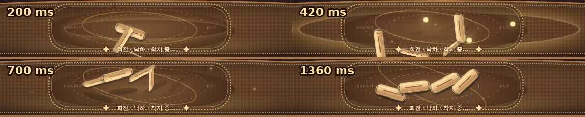

**English** | [한국어 버전 (Korean)](README.md)

# Dalbit Yut (달빛 윷마당) — React + TypeScript & Hugging Face ZeroGPU AI

A modern web adaptation of **Yut Nori (윷놀이)**, Korea’s beloved traditional board game, set against the warm twilight of an autumn Hanok porch.  
Play **Solo vs. AI**, **2–4 Player Local Multiplayer**, or spectate an **Autonomous AI Battle**. Featuring manual tactical piece controls alongside real-time neural network inference powered by **Hugging Face ZeroGPU**.

---

## 🎮 Play Online (Live Demo)

- 🌐 **Web Game (GitHub Pages)**: [https://zaruous.github.io/dalbit-yut/](https://zaruous.github.io/dalbit-yut/)
- 🤗 **Hugging Face Space (ZeroGPU Inference)**: [callakrsos/dalbit-yut](https://huggingface.co/spaces/callakrsos/dalbit-yut)
- 📦 **Hugging Face Model Hub**: [callakrsos/dalbit-yut-laya-1500](https://huggingface.co/callakrsos/dalbit-yut-laya-1500)
- 📄 **Standalone HTML Preview**: [preview.html](./preview.html)

---

## 🔥 Hugging Face ZeroGPU AI Battle & Token Guide

Dalbit Yut connects in real-time to a **Hugging Face Space (A10G ZeroGPU)** running a fine-tuned deep learning decision model trained on 1,500 expert match rollouts.

> [!IMPORTANT]
> **ZeroGPU Quota Notice**:  
> Hugging Face’s ZeroGPU infrastructure allocates an extremely restricted free quota (~1 run/day) for unauthenticated/anonymous IP addresses. Without authentication, consecutive AI turns may trigger a `"ZeroGPU runs limit exceeded"` notification, causing the game to seamlessly fall back to the built-in heuristic AI.  
> By providing your personal **free Hugging Face Read Token**, you unlock your account's generous daily free GPU quota for unlimited smooth play!

### 1. Generating Your Free Hugging Face Read Token (Takes ~10 seconds)
1. Sign in (or create a free account) at [Hugging Face Access Tokens](https://huggingface.co/settings/tokens).
2. Click **`Create new token`**.
3. Select **`Read`** as the token type. (*Write permissions are not needed.*)
4. Give it a name (e.g. `dalbit-yut`), click **`Create token`**, and copy the generated token string (`hf_...`).

### 2. Applying Your Token to the Game (Choose either method)

- **Method A — URL Parameter (Instant & Easiest)**  
  Open the game URL with your token as a parameter. It will automatically save to your browser's local storage:
  ```text
  https://zaruous.github.io/dalbit-yut/?hf_token=hf_your_read_token_here
  ```

- **Method B — In-Game Settings (⚙️)**  
  1. Click the **⚙️ (Settings)** icon in the top right corner of the game.
  2. Expand the **`음악 · 규칙 · 토큰 (Music · Rules · Token)`** details section.
  3. Paste your token (`hf_...`) into the **Hugging Face Token** input box.  
     *(Stored securely in your browser's `localStorage`; never shared or transmitted anywhere except directly in the `Authorization: Bearer` header for ZeroGPU inference.)*

> [!TIP]
> If you choose not to enter a token or your quota runs out, the game's built-in minimax heuristic AI (`chooseAIAction`) takes over immediately without disrupting gameplay.

---

## 🌟 Key Highlights & Features

### 1. 1,500-Instance Fine-Tuned Decision Neural Network
- **Hugging Face Hub**: [`callakrsos/dalbit-yut-laya-1500`](https://huggingface.co/callakrsos/dalbit-yut-laya-1500)
- Fine-tuned on 1,500 high-quality match states gathered through 8-worker parallel rollout simulations with candidate-slot shuffle augmentation.
- Achieves a **70.0% win rate (14 wins, 6 losses)** on the standard square board with a calibrated multi-class Brier score of **0.0583**.
- For full benchmark data and methodology, see [Laya Decision Model Experiments](./docs/laya-experiment.md).

### 2. Mobile Quick Action Dock (`mobile-action-dock`)
- On mobile devices (390×844 and similar viewports), a dedicated control dock appears directly beneath the board displaying **active roll chips**, **waiting piece chips**, and a **confirm move button**.
- Play comfortably with one hand without constant page scrolling.

### 3. Traditional Hanok Twilight Aesthetic & Cinematic 2D Motion
- Scenic SVG vector artwork featuring a wooden porch (*toenmaru*), autumn leaves, gentle lanterns, and sunset mountains.
- Physics-inspired tossing animations: 4 Yut sticks cast from the bottom of the woven mat, executing parabolic flight, rotations, shadows, and realistic bounces.
- Manual control fidelity: Human players pick **Roll Result → Select Piece → Choose Route → Confirm Gold Destination**.

### 4. Strategic Talisman Item Mode
- In addition to standard traditional play, landing on lucky pouch (*bokjumeoni*) tiles grants mystical items:
  - **Geumjul (금줄, Straw Rope)**: Protects against one Nak (sticks falling off the mat).
  - **Side Gate Key (협문 열쇠)**: Allows taking a shortcut gate even when passing through without stopping.
  - **Shield (방패)**: Shields your piece from being captured once by an opponent.

### 5. Original Korean Traditional Soundtrack
- [**Listen to 「Moonlit Twilight on the Porch」(MP3, 80s)**](https://zaruous.github.io/dalbit-yut/audio/moonlit-porch.mp3)
- An original score composed specifically for Dalbit Yut blending gayageum, traditional percussion (janggu, buk), strings, piano, and daegeum flute. [Credits & instrument sources](public/audio/CREDITS.md)

---

## 📸 In-Game Screenshots

| Manual Play (1600×900) | 4-Stage Yut Tossing Sequence |
|:---:|:---:|
|  |  |
| Roll `Geol` ➔ Select Piece ➔ Choose Shortcut ➔ Click Gold Target | 200ms Launch ➔ 420ms Mid-air Spin ➔ 700ms Descent ➔ 1360ms Settle |

| 4-AI Autonomous Spectator Mode | Mobile Quick Action Dock (390×844) |
|:---:|:---:|
|  |  |
| Real-time match observation with pause & replay controls | Streamlined action dock placed directly below the board |

- [Visual Quality Standard & Verification Report](./docs/visual-quality-v1.md)
- [Throw Animation Timing Validation](./docs/throw-animation-validation.md)
- [Heuristic AI Strategy Algorithm](./docs/ai-strategy.md)
- [Map Concept Exploration Gallery](https://zaruous.github.io/dalbit-yut/map-concepts/)

---

## 📜 Rules of Yut Nori

1. **Casting & Outcomes**:
   - **Do** (+1), **Gae** (+2), **Geol** (+3), **Yut** (+4 + extra turn), **Mo** (+5 + extra turn), **Baek-do** (-1 space backwards).
   - Capturing an opponent’s piece grants an immediate bonus roll.
   - Multiple pieces on the same space can stack (*eopgi*) and travel together.
2. **Nak (Out of Bounds)**:
   - If any stick flies **completely** outside the boundaries of the woven mat, that throw is void (Nak). (Sticks overlapping the border remain valid.)
   - Any previously banked Yut or Mo rolls are preserved for movement.
3. **Shortcut Gates**:
   - Shortcuts can only be taken if a piece lands **exactly** on a corner or center intersection node.
4. **4 Distinct Board Layouts**:
   - **Standard Square (S, Default)**: The classic 29-station board with outer lap and inner X-cross. [Layout analysis](./docs/standard-board.md)
   - **Octagonal Ring (A)**: Cyclic outer loop with cardinal cross.
   - **Double Ring (B)**: Dual concentric tracks with radial bridges.
   - **Spiral Garden (G)**: Expanding labyrinth with 4 side gates and lucky pouches.

---

## 💻 Local Setup & Development

**Prerequisites**: Node.js 20.19+ or 22.12+

```bash
# 1. Clone repository & install dependencies
git clone https://github.com/zaruous/dalbit-yut.git
cd dalbit-yut
npm install

# 2. Launch Vite dev server
npm run dev
```

Open `http://localhost:5173` in your browser.

### Quality Assurance & Build Commands

```bash
# TypeScript static type check
npm run typecheck

# Engine unit tests & 225-game simulated benchmark
npm test

# Generate standalone single-file HTML preview
npm run build:preview

# Production build (outputs to dist/)
npm run build
```

---

## 🚀 Deployment

### Deploying to Vercel
Import this repository into Vercel with the following settings:

| Setting | Value |
|---|---|
| **Framework Preset** | Vite |
| **Build Command** | `npm run build` |
| **Output Directory** | `dist` |
| **Install Command** | `npm install` |

### Deploying to GitHub Pages
The project is configured to automatically deploy production build artifacts from `dist/` to the `gh-pages` branch via GitHub Actions.

---

## 📂 Project Architecture

```text
dalbit-yut/
├── src-ts/                    # Canonical TypeScript source code
│   ├── App.tsx                # Main UI, SVG board, interaction handlers, HF Space API
│   ├── gameEngine.ts          # State machine, Nak, capture, stack, victory rules
│   ├── aiEngine.ts            # Built-in heuristic search AI
│   ├── mapEngine.ts           # 4-board graph representations & route routing
│   ├── layaCandidates.ts      # State-to-vector encoder for decision models
│   ├── styles.css             # Base interaction & layout styles
│   ├── theme-cinematic.css    # Cinematic Hanok palette & styling
│   └── quality-v1.css         # Topmost visual QA layer (mobile dock, responsiveness)
├── public/                    # Assets (Hanok SVG background, audio BGM, sound effects)
├── docs/                      # Technical reports, benchmarks, visual QA criteria
├── scripts/                   # Build, test, rollout data collection, benchmark tools
└── preview.html               # Compiled standalone single-file HTML bundle
```

---

## 📄 License & Credits

- Code and Design: [MIT License](./LICENSE)
- Third-Party Notices & Audio Credits: [THIRD_PARTY_NOTICES.md](./THIRD_PARTY_NOTICES.md) · [CREDITS.md](public/audio/CREDITS.md)
- AI Agent Coding Guidelines: [AGENTS.md](./AGENTS.md)
