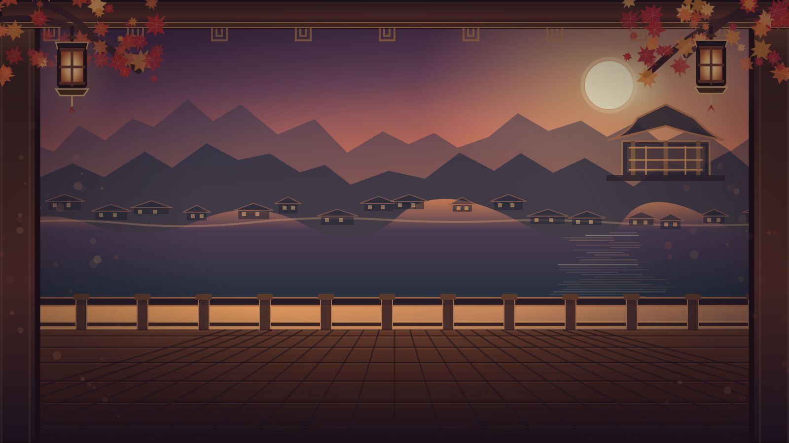

# 달빛 윷마당 — React + TypeScript

한옥 노을을 배경으로 즐기는 **1인 AI / 2~4인 로컬 / AI 자동 대전 관전 윷놀이**. 기본 사각형 윷판에서 시작하며, 직접 플레이할 때는 말과 **황금색 목적지를 눌러** 이동합니다.

## 실제 브라우저 화면 (Visual QA v1.0)



**실제 게임 화면과 이펙트는 [플레이 가능한 HTML 미리보기](./preview.html)에서 확인하세요.**

[**플레이 가능한 HTML 미리보기**](./preview.html) · 모바일 반응형 미리보기 지원 · [시각화 품질 기준 및 검증 보고서](./docs/visual-quality-v1.md)

> 위 이미지들은 그림 콘셉트가 아니라 **실제 React/TypeScript 컴파일 코드를 Chromium에서 실행해 캡처한 장면**입니다. `preview.html`은 빌드된 TypeScript 코드와 배경·스타일·React 런타임을 포함하는 독립 HTML 파일입니다.

## 개선된 디자인

- **독립 배경:** 한옥 마루·노을·산·단풍·등불을 벡터 레이어로 제작했습니다. 배경 이미지에는 윷판, 플레이어 카드, 버튼 같은 UI가 포함되지 않습니다.
- **플레이어 영역:** 캐릭터 아바타, 4개의 말, 진행 상태 바, 현재 차례를 금장 카드로 강조합니다.
- **윷 던지기:** 윷판 **바로 아래**의 짜임 멍석 위에서 4개의 윷가락이 각각 회전·낙하·착지하고 파티클과 결과를 표시합니다.
- **수동 말 이동:** 사용자가 윷 결과 → 말 → 바깥길/지름길 → 금빛 목적지를 선택합니다. 이동 경로 번호, 점프, 착지·잡기·업기 효과를 표시합니다.
- **낙:** 윷가락 중 하나라도 멍석 밖으로 완전히 벗어나면 그 던지기만 무효입니다. 앞서 모은 윷·모 결과가 있으면 그것으로 이동한 뒤 차례가 넘어가고, 없으면 바로 다음 차례로 넘어갑니다. 경계에 부분적으로 걸쳐 있으면 유효로 판정합니다.
- **반응형:** PC에서는 플레이어 / 게임판+던지기 / 조작·로그 3열, 모바일에서는 보드 아래 던지기를 바로 이어서 배치합니다.

## 게임 기능

- 1인 AI 상대 1~3명, 한 기기에서 2~4인 로컬 플레이
- 우측 상단 ⚙ → **나 + AI 대전** → **AI 1명 / 2명 / 3명** 선택 → 시작. AI 3명을 선택하면 나 1명과 청월·초록·홍단 AI가 총 4인으로 대전합니다.
- **AI 관전:** 상단 **AI 관전** 또는 ⚙에서 관전 모드를 고르면 AI 2~4명끼리 자동으로 대전합니다. **일시정지/재개**, 같은 구성으로 **새 AI 대전**을 지원합니다. 정지는 현재 던지기·이동을 마친 뒤 적용됩니다.
- 주소 뒤에 `?watch=1`을 붙이면 기본판에서 AI 4인 관전으로 바로 시작합니다. 예: `/?watch=1&players=3&board=B`는 이중 링형 AI 3인 관전입니다. 일반 주소는 기본판의 사람 + AI 모드로 시작합니다.
- 전략 AI: 완주 거리·잡기·업기·잡힐 위험과 보유 결과 사용 순서를 고려합니다. [판단 방식과 비교 검증](./docs/ai-strategy.md)
- 선택 실험: [Laya 결정 모델 설치·비교 도구와 실험 결과](./docs/laya-experiment.md). 브라우저의 기본 AI는 외부 모델 없이 실행되는 탐색 AI입니다.
- 플레이어별 말 4개, 도·개·걸·윷·모·빽도, 잡기·업기·추가 던지기·승리
- **기본 사각형(S)이 디폴트**이며, 팔각 순환형(A)·이중 링형(B)도 선택할 수 있습니다. 기본판은 외곽 20개와 중앙 X자 지름길 9개, 총 29개 자리입니다. [판 구성과 검증](./docs/standard-board.md)
- 분기점에 **정확히 멈춘 말만** 지름길 진입 선택 가능
- 사용자가 직접 말 선택/이동 확정, AI의 차례만 자동 진행
- 낙 시험 버튼 (낙 확률은 사람과 AI가 동일)

## 로컬 실행

Node.js 20.19+ 또는 22.12+ 권장.

```bash
npm install
npm run dev
```

정적 검증과 브라우저 검토용 HTML 생성:

```bash
npm run typecheck
npm test
npm run build:preview
npm run build
```

`npm test`는 실제 TypeScript 엔진을 컴파일하여 세 맵의 2~4인 게임 **225판**과 탐색 AI 관전 경기 **36판**을 자동 실행합니다. 기본판의 지름길·중앙 정차·빽도·업기·잡기·완주도 별도로 검사합니다.

## Vercel 배포

이 GitHub 저장소를 Vercel에서 Import합니다.

| 설정 | 값 |
|---|---|
| Framework | Vite |
| Install | `npm install` |
| Build | `npm run build` |
| Output Directory | `dist` |

> GitHub 커밋은 완료될 수 있어도 Vercel에 실제 배포되려면 Vercel 프로젝트 연결이 필요합니다.

## 주요 소스

| 파일 | 내용 |
|---|---|
| `src-ts/App.tsx` | React 화면, 직접 말 선택·윷·말 이동 애니메이션 |
| `src-ts/gameEngine.ts` | 게임 상태, 낙·AI·잡기·업기·승리 판정 |
| `src-ts/mapEngine.ts` | 기본 사각형·팔각형·이중 링형 경로와 분기 처리 |
| `src-ts/styles.css` | 공통 레이아웃과 SVG |
| `src-ts/theme-cinematic.css` | 기존 시네마틱 테마 |
| `src-ts/quality-v1.css` | 새 품질 기준용 화면·반응형·이펙트 스타일 |
| `public/hanok-autumn-scene.svg` | UI 잔상이 없는 독립 한옥 배경 |
| `scripts/build-preview.cjs` | TypeScript 컴파일 결과를 단일 HTML로 묶음 |
| `docs/visual-quality-v1.md` | 품질 기준, 자동 검증, 수동 검수 항목 |

## 검증 범위와 주의사항

2026-10-26 Chromium에서 1600×900, 1366×768, 390×844, 360×800 화면을 검사했습니다. **가로 스크롤·런타임 JavaScript 예외 없음**, 수동 말 선택→목적지 클릭, 강제 낙→차례 전환을 확인했습니다. TypeScript 검사와 150판 자동 시뮬레이션도 통과했습니다.

`npm run build`(tsc 타입 검사 + `vite build` → `dist/`)는 로컬과 CI(`.github/workflows/ci.yml`)에서 확인합니다. Vercel 연결 후 배포 로그는 별도로 확인해야 합니다. 애니메이션은 경계 좌표 기반의 2D 연출이며, 3D 물리 엔진은 아닙니다. 해당 맵과 낙 처리는 커스텀 규칙입니다.

라이선스: [THIRD_PARTY_NOTICES.md](./THIRD_PARTY_NOTICES.md) · Codex 가이드: [AGENTS.md](./AGENTS.md)
