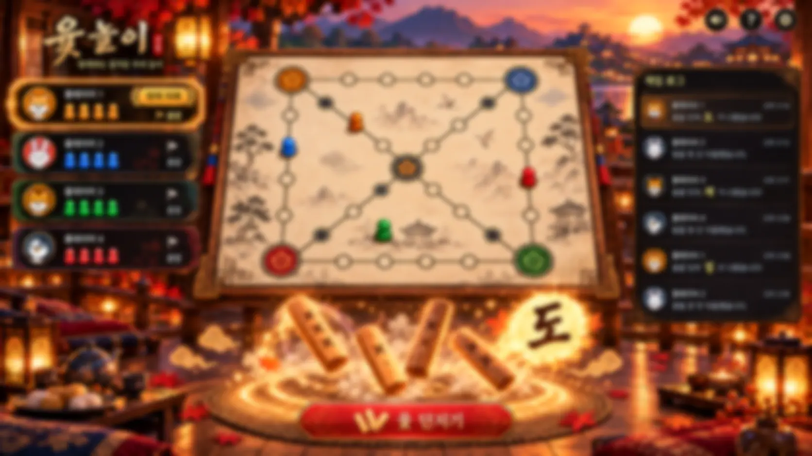

# 달빛 윷마당 — 가을 한옥 시네마틱 에디션 2.0

## 화면 미리보기

*게임에 사용되는 노을빛 한옥 배경 이미지입니다. 실제 윷판과 플레이어 UI는 아래 HTML 미리보기에서 확인할 수 있습니다.*

**[🎮 게임 화면·윷 던지기·말 이동 미리보기](./preview.html)** · **[배경 이미지 파일 보기](./public/hanok-sunset-atmosphere.webp)**

## 새 화면 디자인 (2026-10-24)

- 노을·한옥·단풍의 시네마틱 배경과 전통 금장 프레임
- 현재 차례가 금빛으로 강조되는 최대 4명의 아바타·말 카드
- 윷판 바로 아래의 금빛 멍석, 4개 입체 윷가락, 회전·낙하·낙·결과 파티클
- 결과 선택 → 말 클릭 → 지름길 선택 → **황금색 목적지 클릭**으로 직접 이동
- 빛나는 경로·점프·착지·말 잡기 효과, 모바일에서 윷판 우선 노출
- 스타일은 `src/theme-cinematic.css`, 배경은 `public/hanok-sunset-atmosphere.webp`

[새 단일 HTML 미리보기](./preview.html)를 다운로드해서 바로 열 수도 있습니다.

## 미리보기

`index.html`을 브라우저에서 열면 게임이 실행됩니다. 외부 API, 서버, npm 설치, 네트워크 연결 없이 플레이 가능합니다. `preview.html`은 CSS/JavaScript/배경을 하나로 합친 파일로, 별도 폴더 없이 열리는 독립 미리보기입니다.

## 게임 조작: 사용자가 직접 말을 움직입니다

1. 중앙 윷판 **바로 아래의 멍석**에서 **윷 던지기**를 누릅니다.
2. 우측에서 사용할 **도·개·걸·윷·모·빽도 결과**를 고릅니다. 하나라면 자동 선택됩니다.
3. 좌측 **출발 대기 말** 또는 윷판 위에 **빛나는 자기 말**을 누릅니다.
4. 분기점에 정확히 멈춘 말이면 **바깥길 유지/지름길 진입** 경로를 고릅니다.
5. 윷판에 나타난 **황금색 목적지**를 누르거나 `선택한 말 이동` 버튼을 누르면 한 칸씩 점프하며 이동합니다.
6. AI 대전의 상대 AI는 자신의 차례만 자동으로 행동합니다. 2–4인 로컬 모드는 모든 사용자가 직접 조작합니다.

## 구현 기능

- 새 디자인: 야경 속 한옥·달빛·낙엽 배경, 한지 윷판, 애니메이션, 게임 이벤트 기록
- 게임 모드: 1인(AI 상대 1–3명), 로컬 2–4인(한 기기에서 번갈아 플레이)
- 말 4개, 도/개/걸/윷/모/빽도, 빽도 실제 경로 역추적, 윷/모 추가 던지기
- 잡기/업기, 잡으면 추가 던지기, 말 4개 완주 판정
- 팔각 순환형 A / 이중 링형 B, 분기점에 **정확히 멈춘 뒤** 다음 이동 시 지름길 선택
- 멍석 경계 안에 윷이 일부 걸쳐 있을 때 유효. 윷가락 한 개라도 완전히 밖이면 낙, 말 이동 취소 및 차례 교대
- 윷가락별 착지 위치와 회전 각도를 사용해 낙 판정. 던지기 힘 조절 및 `낙 시험` 제공
- 칸별 말 이동 애니메이션, 이동 경로/목적지 강조, 잡기/업기/착지 강조
- PC/태블릿/모바일 반응형, 소리 ON/OFF

## Vercel 배포

1. 이 폴더의 파일을 GitHub 저장소 최상위에 업로드하세요.
2. [Vercel](https://vercel.com/) → **Add New Project** → 저장소 선택.
3. Framework Preset: **Other** (정적 React 프로젝트), Build Command: **비워 두기**, Output Directory: **비워 두기**.
4. Deploy를 누르면 최상위 `index.html`을 통해 실행됩니다.

`vercel.json`은 정적 배포 기준입니다. React와 ReactDOM을 `vendor/`에 포함해 npm 설치/원격 CDN이 필요하지 않습니다.

## 파일 구성

- `index.html`: 앱 진입점
- `src/App.js`: React 화면 및 수동 선택/목적지/애니메이션
- `src/gameEngine.js`: 게임 규칙, AI 선택, 낙 처리, 잡기/업기/완주
- `src/mapEngine.js`: 팔각 순환형/이중 링형 그래프와 실제 경로
- `src/styles.css`: 배경/보드/UI/효과/반응형
- `public/hanok-night.svg`: 새로 그린 밤 풍경 배경
- `vendor/*`: React 16.0.0 및 ReactDOM 16.0.0 UMD (MIT 라이선스)
- `test-engine.cjs`: 실제 엔진 동작 테스트 (Node.js)

## 검증

- 2개 맵, 2–4인 규칙 무작위 게임 150판 종료, 16,972건 엔진 체크 통과
- 브라우저 실제 클릭: 말 직접 선택 → 목적지 이동, 분기 지름길 선택, 강제 낙 판정, AI 차례 자동 처리, PC/모바일 레이아웃 확인
- 정밀 3D 물리 엔진이 아닌 **2D 착지 위치+회전 사각형 경계 판정 시뮬레이션**입니다.

## 변형 규칙 고지

팔각형과 이중 링형은 기존 윷놀이를 바탕으로 설계한 **커스텀 맵**이며, 전통 윷판의 공식 규칙과 완전히 동일한 판형은 아닙니다. 이 게임의 선택 규칙: 정확히 분기점에 멈춘 말만 다음 이동에서 지름길 선택, O0 도착점에 정확히 안착한 말은 다음 전진 시 완주, 낙 발생 시 보유 이동 결과를 포기하고 턴 종료. 빽도가 첫 칸에서 나오면 말은 대기 상태로 돌아갑니다.

## 라이선스

게임의 새 디자인과 코드: 재사용 가능. 동봉된 React/ReactDOM 라이브러리는 별도 MIT 라이선스에 따릅니다. `THIRD_PARTY_NOTICES.md` 참조.

## Codex로 이어서 개발하기

이 저장소를 Codex에서 열고 `AGENTS.md`를 먼저 읽으세요. `src/gameEngine.js`와 `src/mapEngine.js`는 규칙·경로 엔진이고, `src/App.js`는 말 선택/목적지 클릭/AI 턴·이펙트 UI입니다.

- 설치 없이 정적 호스팅 가능 (`index.html`, `vendor/`, `src/`, `public/`)
- 로컬 실행: `python -m http.server 8000` 후 `http://localhost:8000`
- 게임 규칙 테스트: `npm test` (Node.js 필요, 외부 라이브러리 설치 불필요)
- 변경 후 두 맵 및 직접 말 이동/낙 판정을 재검증하세요.
