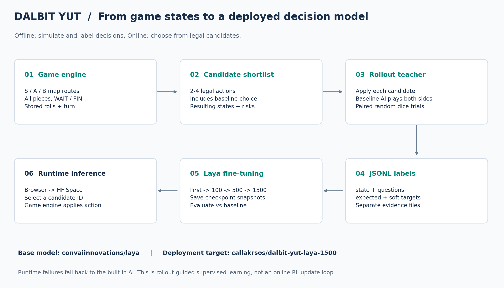
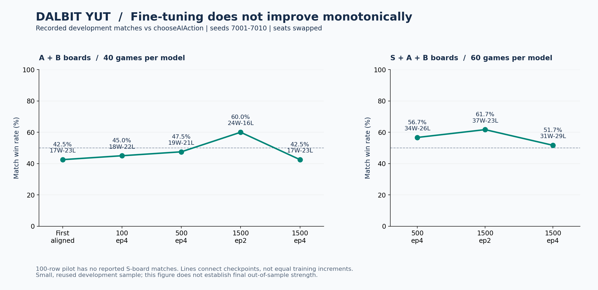
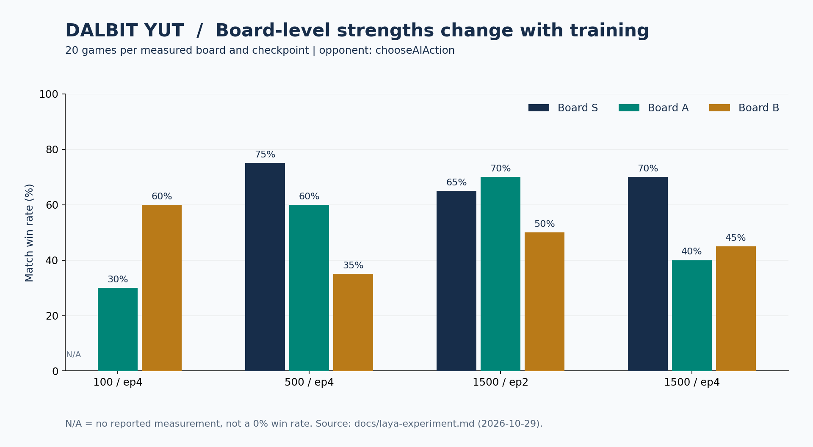

# 윷놀이 AI 개발기: Laya 파인튜닝과 100·500·1500건 학습 데이터, 승률 비교

윷놀이 AI를 더 강하게 만들려면 학습 데이터를 늘리기만 하면 될까? **달빛 윷마당(Dalbit Yut)**에서는 기존 탐색 AI가 있는 React·TypeScript 게임에 Laya 결정 모델을 연결하고, 자동 시뮬레이션으로 만든 데이터로 추가 학습했다. 기록된 개발 대결에서 500건 모델의 S·A·B 종합 승률은 **56.7%**, 1,500건·2 epoch 모델은 **61.7%**였다. 같은 데이터를 4 epoch까지 학습한 모델은 **51.7%**로 내려갔다.

이 글에서는 어떤 모델을 사용했는지, 맵과 말 위치를 어떻게 표현했는지, 정답 데이터를 어떻게 만들었는지, 승률을 어떤 조건에서 비교했는지 차례로 살펴본다. 숫자는 기존 실험 보고서의 기록을 옮긴 것이며, 이 글을 작성하면서 새로 학습하거나 대결을 실행한 결과는 아니다.

실행 환경의 핵심은 **Google Colab에서 학습하고 Google Drive에 체크포인트를 보관하는 흐름**, 그리고 **GPU 없이도 CPU로 추론할 수 있는 모델**이라는 점이다. 후속 실험에는 로컬 GPU도 사용했다. 학습 장비와 서비스 장비를 분리할 수 있지만, CPU 서비스의 응답 시간은 별도로 검증해야 한다.


*저장소에 있는 실제 게임 화면. 게임 규칙과 이동은 TypeScript 엔진이 담당하고, 신경망은 주어진 후보 중 하나를 선택한다.*

## 목차

- [사용한 기본 모델과 추가 학습 계보](#사용한-기본-모델과-추가-학습-계보)
- [Google Colab 학습과 Google Drive 저장, 로컬 PC의 역할](#google-colab-학습과-google-drive-저장-로컬-pc의-역할)
- [학습 데이터는 어떻게 만들었나](#학습-데이터는-어떻게-만들었나)
- [맵 경로와 말 배치를 표현하는 방법](#맵-경로와-말-배치를-표현하는-방법)
- [JSONL 학습 데이터 구조](#jsonl-학습-데이터-구조)
- [100·500·1500건 모델의 승률 비교](#1005001500건-모델의-승률-비교)
- [학습 지표와 경기 승률은 다르다](#학습-지표와-경기-승률은-다르다)
- [Hugging Face 배포와 게임 연결](#hugging-face-배포와-게임-연결)
- [GPU 없이도 가능한 CPU 추론](#gpu-없이도-가능한-cpu-추론)
- [추가 학습을 위한 다음 실험](#추가-학습을-위한-다음-실험)
- [자주 묻는 질문](#자주-묻는-질문)
- [소스와 재현 범위](#소스와-재현-범위)

## 사용한 기본 모델과 추가 학습 계보

기본 체크포인트는 **[`convaiinnovations/laya`](https://huggingface.co/convaiinnovations/laya)**다. Laya는 이 프로젝트에서 자유로운 문장을 생성하는 채팅 모델이 아니라, 전달받은 고정 선택지 중 하나를 고르는 **비생성형 결정 모델**로 사용된다. 윷놀이 규칙에 특화된 모델을 처음부터 사전 학습한 것은 아니다.

| 단계 | 입력 가중치 | 결과 체크포인트 | 확인한 내용 |
|---|---|---|---|
| 첫 파인튜닝 | `convaiinnovations/laya` | `checkpoint-first` | 기존 코드 AI의 선택을 모방하는 출발 단계 |
| 100건 파일럿 | `checkpoint-first` | `checkpoint-rollout-pilot` | Rollout 확률 분포 데이터로 4 epoch 학습 |
| 500건 | `checkpoint-rollout-pilot` | `checkpoint-rollout-500` | 500건 데이터로 4 epoch 추가 학습 |
| 1,500건 중간 | `checkpoint-rollout-500` | `checkpoint-rollout-1500-ep2` | 2 epoch 시점 스냅샷 |
| 1,500건 최종 | `checkpoint-rollout-500` | `checkpoint-rollout-1500` | 4 epoch 완료 모델 |

1,500건·2 epoch와 4 epoch 모델은 같은 추가 학습 실행의 서로 다른 시점이다. `100 → 500 → 1500`은 단계별 데이터셋 규모를 가리킨다. **게임 판수나 epoch 수가 아니며, 중복 없는 누적 데이터 수라는 뜻도 아니다.** 1,500건 데이터셋이 기존 500건에 새 1,000건을 정확히 합친 구성인지까지는 공개 기록으로 확인할 수 없다. 별도의 1,000건 모델 기록도 없다.

첫 학습 노트북에는 6,000건 생성·1,200건 평가 명령이 있지만, 명령 예시와 실제 실행된 데이터셋의 상세 이력은 구분해야 한다. 특히 뒤의 Rollout 노트북에도 예전 설정과 코드 번들이 포함되어 있어, 실행 템플릿만으로 각 실험을 그대로 재현했다고 볼 수는 없다.



*오프라인 데이터 생성과 학습, 온라인 후보 선택을 구분한 구조도. 도표의 영문 라벨은 코드의 역할을 요약한다.*

## Google Colab 학습과 Google Drive 저장, 로컬 PC의 역할

초기 학습은 **Google Colab의 실행 환경과 GPU를 사용하고, Google Drive를 마운트해 학습 결과를 저장**하도록 구성했다. Google Drive 자체가 GPU 연산을 수행하는 것은 아니다. Colab 세션이 끝나도 체크포인트를 보관하고 PC로 가져와 평가할 수 있도록 저장 경로를 분리한 것이다.

```python
# 저장소의 첫 Colab 노트북에 있는 구성
from google.colab import drive
drive.mount('/content/drive')
```

학습 명령의 출력 경로는 `/content/drive/MyDrive/dalbit-yut-laya/checkpoint`다. 노트북 메타데이터는 T4 GPU로 설정되어 있지만, 실제 배정 GPU는 실행 시 `nvidia-smi`로 확인해야 한다. 후속 파일럿·500·1,500건 학습은 보고서에 로컬 RTX 3070 실행으로 기록되어 있어 모든 학습을 Colab에서 했다고 표현하지 않는다.

| 환경 | 담당한 역할 | 기록으로 확인되는 범위 |
|---|---|---|
| Google Colab | 초기 파인튜닝 실행 | GPU 학습 명령, Drive 마운트 코드 |
| Google Drive | 체크포인트·보고서 저장과 이동 | `MyDrive/dalbit-yut-laya/` 경로; 첫 모델을 PC로 복사한 기록 |
| 로컬 CPU | Rollout 데이터 생성 | 파일럿 4스레드, 후속 8 Worker |
| 로컬 GPU | 후속 추가 학습·대결 평가 | 보고서상 RTX 3070; 초기 비교에는 RTX 4050 Laptop GPU도 등장 |
| Hugging Face Hub | 배포할 가중치 보관 | `callakrsos/dalbit-yut-laya-1500` |
| Hugging Face Space | 게임의 추론 API 서비스 | 저장소 코드는 CUDA/ZeroGPU 구성; CPU 전환 방향은 아래 설명 |

위 GPU 이름은 **실험 기록에 적힌 장비**다. 현재 개인 PC 사양을 조회한 결과와는 구분한다. 재현성을 위해 실행마다 GPU 이름, VRAM, PyTorch·Transformers 버전과 모델 리비전을 함께 남기는 것이 좋다.

## 학습 데이터는 어떻게 만들었나

사람의 플레이 기록을 수작업으로 라벨링하는 대신, **게임 엔진이 상황을 만들고 Rollout 교사가 후보들을 평가**한다. 한 건은 한 경기 전체가 아니라, 여러 수 중 하나를 골라야 하는 한 번의 판단 상황이다.

1. **게임 자동 진행:** S·A·B 맵을 번갈아 사용한다. 플레이어별 난수 스트림을 시드로 고정해 윷 결과를 재현할 수 있게 한다.
2. **합법 후보 구성:** 게임 엔진이 가능한 행동을 계산한다. 기존 `chooseAIAction`의 추천을 포함하고, 즉시 승리·완주·잡기·업기·지름길 이득 등을 고려해 최대 4개로 추린다. 하나뿐인 후보는 학습 행으로 저장하지 않는다.
3. **후보별 미래 대결:** 각 후보를 실제로 적용한 상태에서 게임 종료까지 여러 번 진행한다. 이후의 수는 양쪽 모두 기존 코드 AI가 선택하고, 윷 결과를 난수로 바꾼다. 따라서 모든 행동을 무작위로 고르는 대결은 아니다.
4. **동일 조건 비교:** 같은 trial의 후보들은 같은 시드를 사용한 대결로 비교한다. 후보당 승리 횟수를 시뮬레이션 수로 나누어 `winRates`를 얻는다.
5. **정답과 목표 분포 저장:** 가장 좋은 후보를 `expected`로 저장하고, 분포 학습에서는 후보별 승률을 변환한 `gold.move.probabilities`도 넣는다.

현재 교사는 **현재 후보를 바꾼 뒤 기존 AI가 양쪽을 계속 플레이하는 정책**을 평가한다. 이 라벨은 모든 미래 전략을 탐색한 최적해가 아니다. 후보가 최대 4개인 만큼, 추려지지 않은 합법 수는 모델과 교사의 비교 대상에 들어가지 않는다.

### 단계별 데이터 생성 조건

| 항목 | 100건 파일럿 | 500건 | 1,500건 |
|---|---|---|---|
| 학습 측 데이터 | 100건 중 Train 90 / Calib 10 | 학습용 500건 | 학습용 1,500건 |
| 별도 평가 데이터 | 100건 | 100건 | 300건 |
| 후보당 Rollout | 256회 | 128회 | 해당 실험 절에 횟수 미기재 |
| CPU 병렬 처리 | 4스레드 | 8 Worker 스레드 | 8 Worker 스레드 |
| 보드별 학습 행 | 상세 수 미기재 | S 164 / A 154 / B 182 | S 456 / A 451 / B 593 |
| 기존 AI와 다른 탐색 선택 | Train 37% / Eval 47% | 보고서상 237건, 47.4% | 미기재 |

500·1,500건은 보고서의 학습용 데이터 행 수다. 학습 CLI 내부에서 별도로 나눈 보정 데이터 규모는 해당 보고서 절에 명시되어 있지 않다. 500건의 `disagreement` 수치는 보고서 인용이며, 원본 행을 재집계한 값은 아니다.

데이터 생성기의 기본값은 `baseline` 교사와 `expected` 라벨이다. **Rollout 분포 데이터를 만들려면 환경변수를 명시해야 한다.** 아래는 현재 생성기를 이용하는 500건 구성 예시이며, 과거 실험의 명령 로그를 복사한 것은 아니다.

```bash
# 의존성 설치 및 npm test를 통해 build-test 엔진을 준비한 뒤 실행
LAYA_TEACHER=rollout \
LAYA_LABEL_MODE=distribution \
LAYA_ROLLOUT_SAMPLES=128 \
LAYA_ROLLOUT_VALIDATION=0 \
LAYA_ROLLOUT_THREADS=8 \
node scripts/generate-laya-training.cjs 500 100 laya-data/example-rollout-500
```

학습 명령은 노트북의 `laya-train` 형식을 사용한다. 아래는 앞에서 만든 예제 데이터에 이어 실행할 수 있도록 경로를 맞춘 템플릿이다. Laya 학습 환경과 이전 체크포인트가 준비되어 있어야 하며, 기존 결과를 덮어쓰지 않도록 새 출력 경로를 사용한다.

```bash
laya-train \
  --data laya-data/example-rollout-500/train.jsonl \
  --eval laya-data/example-rollout-500/eval.jsonl \
  --base laya-data/checkpoint-rollout-pilot \
  --out laya-data/example-checkpoint-500 \
  --device cuda --loss soft-ce --shuffle-options \
  --epochs 4 --micro-batch 1 --grad-accum 32 \
  --max-len 1024 --head-max-len 512
```

`soft-ce`는 분포 목표를 사용하는 손실 설정, `micro-batch`와 `grad-accum`은 메모리 사용과 기울기 누적을 조절하는 설정이다. 이 명령은 노트북 설정을 바탕으로 재구성한 예시이며 각 과거 실행의 전체 하이퍼파라미터 로그를 보증하지 않는다.

생성기는 학습 시드 오프셋 `10000`, 평가 오프셋 `50000`에서 시작한다. 학습 입력과 동일한 `state + questions`를 평가에서 제외하고, 각 수집 집합에서는 완전히 동일한 행을 걸러낸다. 이 필터는 **동일 입력 제거**이며, 비슷한 배치나 단계 간 데이터 중복까지 모두 검증했다는 뜻은 아니다. 생성된 manifest에서 실제 사용한 시드 범위와 중복도 추가 확인하는 것이 좋다.

## 맵 경로와 말 배치를 표현하는 방법

모델 입력에 맵 이미지나 화면의 `(x, y)` 좌표를 넣지는 않는다. **맵의 연결 경로와 자리 ID, 각 말이 속한 경로를 영어 문자열로 직렬화**한다. 원본 맵 그래프는 엔진에 있고, `rulesFor(board)`가 모델용 경로 설명을 만든다.

| 필요한 정보 | 입력 표현 |
|---|---|
| 내 말과 상대 말 | 플레이어별 전체 말 목록 `P0[...] P1[...]` |
| 말 위치 | `node`: `O5`, `C`, `I4` 등 |
| 출발 대기 | `node = WAIT` |
| 완주 | `node = FIN` |
| 진행 경로 | `lane` |
| 최근 이동 경로 | 보드 위 말의 `history` 최근 최대 6개 |
| 업힌 말 | 같은 편 말들의 동일 자리 배치로 표현; 후보에는 이동 묶음 수 포함 |
| 사용 가능한 윷 | `Stored results`: 도·개·걸·윷·모·빽도 |
| 현재 진행 상태 | 현재 플레이어, phase, turn |

중앙에 있는 말은 같은 `C` 자리라도 어느 경로로 진입했는지에 따라 다음 이동이 달라질 수 있다. 따라서 위치만 나열하는 대신 `node/lane`과 최근 이력을 함께 제공한다. `O0`는 보드 위 완주 직전 체크포인트이고, `FIN`과 구분된다.

### 학습 입력에 포함되는 세 맵의 경로

아래는 코드의 경로 설명을 읽기 쉽게 옮긴 것이다. `…`는 연속된 외곽 자리를 줄여 쓴 표기다.

| 맵 | 외곽 | 지름길·내부 경로 |
|---|---|---|
| S 표준 사각 | `O0 → O1 → … → O19 → O0 → FIN` | `O5 → NE1 → NE2 → C → SW1 → SW2 → O15`; `O10 → NW1 → NW2 → C → SE1 → SE2 → O0` |
| A 팔각 | `O0 → O1 → … → O23 → O0 → FIN` | `O6 → NE1 → NE2 → C → SW1 → SW2 → O18`; `O12 → NW1 → NW2 → C → SE1 → SE2 → O0` |
| B 이중 링 | `O0 → O1 → … → O23 → O0 → FIN` | `O6 → I0 → I1 → … → I8 → R1 → O0`; `O12 → W0 → I4 → … → I8 → R1 → O0` |

S·A에서는 NE 경로로 중앙 `C`에 도착해 멈춘 뒤 출발할 때 SW 방향 진행 또는 `C → SE1 → SE2 → O0` 분기를 선택할 수 있다. 대기 말의 빽도 제한, 잡기·업기, 추가 던지기, 저장된 윷 결과의 사용 순서도 공통 규칙에 포함된다.

규칙 문자열에는 빽도·도·개·걸·윷·모의 확률을 각각 `1/16, 3/16, 6/16, 4/16, 1/16, 1/16`로 넣는다. 이는 이 게임 구현의 분포다. 현재 데이터 생성 대상은 **S·A·B**이며, 게임에 존재하는 **G 나선정원과 아이템전은 이 실험으로 검증한 범위에 포함하지 않는다.**

### 후보에는 이동 후 상태까지 넣는다

`criteria.a0` 같은 후보 문자열에는 사용할 윷 결과, 말 ID, 이동 묶음 수, 경로, 실제 이동 자리들이 들어간다. 여기에 즉시 잡기·업기·완주·승리 여부, 이동 후 모든 말의 위치, 남은 결과, 다음 단계와 차례, 최단 완주 거리, 상대의 한 번 던지기 도달 확률을 덧붙인다.

모델은 엔진이 계산한 후보의 결과들을 읽고 비교한다. 상대의 도달 확률은 계산된 특징값이며, 실제로 그 말이 잡힐 최종 확률이나 전체 경기 패배 확률과 동일하지 않다. 실제 미래의 윷 난수는 입력에 제공하지 않는다.

## JSONL 학습 데이터 구조

실제 파일은 **한 줄에 JSON 객체 하나**를 넣는 JSONL이다. 다음은 필드 구조를 보여주는 축약 예시다. 문장과 확률은 설명을 위한 값이며, 실제 수집 행을 공개한 것이 아니다. 실제 `state`와 후보 문자열은 영어이며 규칙·경로·전체 배치를 포함해 훨씬 길다.

```json
{
  "state": "House rules and Map S routes... Full piece state... Stored results: geol(3).",
  "questions": {
    "move": {
      "type": "choice",
      "instructions": "Choose the legal Yutnori move with the highest long-term probability of winning.",
      "criteria": {
        "a0": "Candidate 0: move path, immediate effects, resulting positions and risk...",
        "a1": "Candidate 1: move path, immediate effects, resulting positions and risk..."
      }
    }
  },
  "expected": {"move": "a0"},
  "gold": {
    "move": {
      "probabilities": {"a0": 0.73105858, "a1": 0.26894142}
    }
  }
}
```

| 필드 | 역할 | 실제 추론에 필요한가 |
|---|---|---|
| `state` | 규칙·맵·전체 배치·보유 결과 | 필요 |
| `questions.move` | 지시문과 후보 목록 | 필요; 서버에서 질문 구조를 구성 |
| `expected.move` | 교사가 선택한 후보 ID | 정답·평가용 |
| `gold.move.probabilities` | 분포 학습용 목표 확률 | 학습용 |

`a0`는 고정된 전략 이름이 아니라 그 상황의 후보 번호다. 후보를 만드는 코드에서는 순서를 턴별로 회전시키고, 학습 명령의 `--shuffle-options`는 학습 중 선택지 순서를 섞어 위치 편향을 줄이도록 한다. 이 기능을 사용했다고 편향이 완전히 사라졌다고 단정할 수는 없다.

### 시뮬레이션 승률과 목표 확률의 차이

후보별 Rollout 승률을 `q_i`, 온도를 `T`라고 하면 목표 확률은 다음과 같다.

```text
p_i = exp((q_i - max(q)) / T) / sum_j exp((q_j - max(q)) / T)
T의 기본값 = 0.1
```

앞의 두 후보 예시는 시뮬레이션 승률이 `0.7, 0.6`일 때 변환한 값이다. `0.7311`은 후보 0의 실제 승률 73.11%를 뜻하지 않는다. **학습할 상대적 선호 비중**이다. 분포 모드는 별도 재확인 예산이 0일 때만 허용되며, 일반 `expected` 모드에는 `gold`가 없다. 재확인을 켠 정책에서는 최고 실측 승률 후보가 기존 AI보다 유리한지 새 난수로 재확인하고, 통과하지 못하면 기존 추천을 유지할 수 있다.

### 정답 생성 근거는 별도 보관한다

| 파일 | 내용 |
|---|---|
| `train.jsonl` | 학습용 상태·질문·정답·목표 분포 |
| `eval.jsonl` | 별도 평가용 상태·질문·정답·목표 분포 |
| `train-evidence.jsonl` | 각 학습 행의 보드·시드·step·선택·기존 추천·후보별 승률 |
| `eval-evidence.jsonl` | 평가 행의 생성 근거 |
| `manifest.json` | 교사 종류·시뮬레이션 수·라벨 모드·온도·병렬 수·보드별 행 수·게임 수 등 |

`evidence`의 `row`는 0부터 시작하는 대응 행 번호, `answer`와 `baseline`은 후보 인덱스다. `step`은 생성 루프의 진행 단계로, 게임의 턴 번호와 동일한 개념은 아니다. `validation`에는 별도 재확인 결과가 들어가며 없으면 `null`이다.

## 100·500·1500건 모델의 승률 비교

대결 상대는 기존 탐색 AI **`chooseAIAction`**이다. 아래 후속 모델 비교는 보고서에 기록된 **시드 7001~7010, 맵별 선후공 교대 20판**을 기준으로 한다. A·B는 합계 40판, S·A·B는 60판이다. 100건 파일럿에는 S 맵 대결 기록이 없으므로 종합 60판 결과를 계산하지 않는다.

| 학습 데이터 | 학습 시점 | S 표준 사각 | A 팔각 | B 이중 링 | A·B 합계 | S·A·B 합계 |
|---|---|---|---|---|---|---|
| 100건 | 4 epoch | 기록 없음 | 6승 14패 · 30% | 12승 8패 · 60% | 18승 22패 · **45.0%** | — |
| 500건 | 4 epoch | 15승 5패 · 75% | 12승 8패 · 60% | 7승 13패 · 35% | 19승 21패 · **47.5%** | 34승 26패 · **56.7%** |
| 1,500건 | 2 epoch | 13승 7패 · 65% | 14승 6패 · 70% | 10승 10패 · 50% | 24승 16패 · **60.0%** | 37승 23패 · **61.7%** |
| 1,500건 | 4 epoch | 14승 6패 · 70% | 8승 12패 · 40% | 9승 11패 · 45% | 17승 23패 · **42.5%** | 31승 29패 · **51.7%** |



*왼쪽은 같은 A·B 개발 평가, 오른쪽은 S까지 포함한 평가다. 첫 모델의 지시문 정렬 결과는 A·B 17승 23패(42.5%)다. 그래프의 선은 체크포인트 순서이며, 같은 양의 추가 데이터나 같은 epoch 간격을 뜻하지 않는다.*

100건에서 1,500건·2 epoch까지 A·B 승률은 **45% → 47.5% → 60%**, 즉 파일럿 대비 **15%p** 높아졌다. 첫 모델의 지시문 정렬 결과 42.5%와 비교하면 **17.5%p**다. S·A·B에서는 500건 대비 1,500건·2 epoch가 **5%p**, 3승 더 높은 기록을 냈다.



*맵별로 보면 개선 방향이 다르다. 500건 모델은 S에서 75%였지만 B는 35%였다. 1,500건·2 epoch는 S 65%, A 70%, B 50%로 이 개발 평가에서 더 높은 종합 결과를 보였다.*

각 맵은 20판이므로 **한 경기 차이가 5%p**다. 후속 모델은 같은 개발 시드를 반복 사용했다. 따라서 이 결과는 체크포인트 선택을 돕는 개발 지표이지, 새로운 사용자·시드·게임 모드에서도 같은 승률을 보장하는 최종 독립 검증은 아니다. 61.7%와 56.7%의 차이가 통계적으로 확정된 우위라고 주장하지 않는다.

### 원본 모델과 첫 파인튜닝의 기록

원본 Laya는 초기 축약 입력 실험의 A·B 100판에서 21승 79패(21%), 상세 입력 v2를 적용한 별도 시드 100판에서 11승 89패(11%)였다. 같은 2차 시드에서 축약 v1을 다시 실행한 결과는 14%였다. 입력 버전과 시드가 다르므로 세 숫자를 학습 성능의 연속 상승·하락으로 연결하면 안 된다.

첫 파인튜닝 모델은 시드 7001~7100의 A·B 400판에서 **178승 222패(44.5%)**를 기록했다. 보고서의 시드 군집 bootstrap 95% 구간은 40.25~48.75%다. 이후 40판 지시문 비교에서는 기존 지시문 35%, 학습 지시문 42.5%였다. 400판 결과와 40판 결과 역시 표본과 지시문 조건을 구분해야 한다.

## 학습 지표와 경기 승률은 다르다

데이터셋에서 교사 선택을 잘 맞히는 것과 게임 전체에서 이기는 것은 다른 목표다. 이 프로젝트에서도 정답 일치율·Loss·ECE·Brier와 실제 대결 승률을 나누어 기록했다.

| 단계 | 보고된 평가 지표 | 해석 범위 |
|---|---|---|
| 첫 파인튜닝 | 정답 일치율 63.75% → 92.08% | 평가 1,200개 중 44개가 학습/보정 데이터와 겹쳐 독립 평가로 볼 수 없음 |
| 100건 파일럿 | Eval 100건 Loss 3.2214 → 1.1139; ECE 0.3942 → 0.1760; Brier 0.3772 → 0.1352 | 해당 평가 데이터에서 손실·보정 관련 지표 개선 |
| 500건 | Eval 100건 Accuracy 41% → 49%; Loss 1.2250 → 1.0165; ECE 0.2394 → 0.0851; Brier 0.2075 → 0.0901 | 해당 실험 전후 변화 |
| 1,500건 | Eval 300건 Accuracy 52.67% → 57%; Brier 0.0583 | 보고서의 단계 요약값; epoch별 상세 지표는 공개되어 있지 않음 |

Accuracy는 교사의 선택과 일치하는 비율이다. ECE는 확률 보정을 보는 지표이며, Brier는 예측 분포와 목표의 오차를 평가한다. 낮은 ECE나 Brier가 실제 윷놀이 승률을 직접 보정했다는 뜻은 아니다. 특히 서로 다른 평가셋과 라벨을 쓴 단계 간 숫자를 그대로 순위화해서는 안 된다.

4 epoch 모델이 2 epoch보다 낮은 대결 승률을 기록한 원인은 과적합, 최적화 변동, 교사 라벨의 한계, 작은 평가 표본 등으로 추정할 수 있다. 현재 요약 기록만으로 한 원인을 확정할 수는 없다. **학습을 오래 했는지보다, 별도 대결에서 어떤 체크포인트가 잘 작동했는지를 확인하는 것이 핵심이다.**

## Hugging Face 배포와 게임 연결

저장소의 `hf-space/app.py`는 **`callakrsos/dalbit-yut-laya-1500`**을 불러오도록 설정되어 있다. React 게임은 상황과 합법 후보를 보내고, 서버는 Laya로 후보 ID를 선택해 응답한다. 실제 이동 적용과 규칙 검증은 게임 엔진이 맡는다.

| 구성 요소 | 역할 |
|---|---|
| React·TypeScript 게임 | 사용자 조작, 상태 관리, 합법 후보와 입력 구성 |
| Hugging Face Space | Gradio API와 GPU 추론 |
| Laya 체크포인트 | 후보 2~4개 중 하나 선택 |
| 기존 탐색 AI | 후보 추천과 추론 실패 시 fallback |

배포 코드의 추론 제한은 `max_len=1024`, `head_max_len=512`다. 입력 잘림과 잘못된 후보 응답을 검사한다. 모델 다운로드 크기나 모바일 비용을 감수하며 브라우저에서 직접 가중치를 실행하는 구조와는 다르다.

업로드 스크립트의 기본 디렉터리는 `laya-data/checkpoint-rollout-1500`이다. 다만 **저장소 설정만으로 현재 Hub 가중치가 정확히 어느 epoch 파일과 같은지 증명할 수는 없다.** 성능이 가장 높았던 ep2 모델과 배포 ID를 동일하다고 간주하지 않으며, 배포 버전을 검증하려면 Hub 리비전과 원본 파일 해시를 대조해야 한다. 이 글에서는 실시간 서비스 상태나 Hub 가중치를 별도로 검증하지 않았다.

실험에서는 실제 모델 선택(`laya`), 후보가 하나인 강제 수(`forced`), 오류로 기존 AI를 사용한 판단(`fallback`)을 분리해 집계한다. fallback이 섞이면 순수 신경망의 선택 성능과 구분해야 한다. 보고서에 명시된 파일럿·500건 대결의 fallback은 0회다.

로컬 서버에는 SQLite의 `matches`와 `ai_moves`에 경기·판단 정보를 남기는 코드도 있다. 정적 웹만 실행한다고 이 로컬 DB에 모든 이용자의 대결이 자동 수집되거나, 모델이 실시간으로 재학습되는 것은 아니다.

## GPU 없이도 가능한 CPU 추론

**Laya 추론에 GPU가 필수인 것은 아니다.** 프로젝트의 로컬 worker는 `cpu`, `cuda`, `auto`를 지원하고, 기본 장치는 `cpu`다. 실험 보고서에도 실제 CPU 모델 추론 성공 기록이 있다. 따라서 Colab이나 로컬 GPU에서 학습한 가중치를 CPU 환경에서 불러오는 실행 경로를 갖추고 있다. 다만 배포된 1,500건 체크포인트 자체의 CPU 성능을 측정한 별도 기록은 확인하지 못했다.

| 확인 항목 | 보고서의 CPU smoke test |
|---|---|
| 성공한 모델 추론 | 21회 |
| 성공한 추론의 평균 시간 | 2.44초 / 선택 |
| 실패 상황 | 한 번의 5초 제한 초과 후 worker 종료 |
| 이후 fallback | 48회 |
| 승률 평가 사용 여부 | 해당 4판은 승률 근거에서 제외 |

이 결과는 **CPU 실행 가능성의 근거**다. 동시에 낮은 지연 시간을 보장하는 근거는 아니다. CPU 환경에서는 모델 로딩 시간, 스레드 수, 동시 요청 수와 판단 제한 시간을 함께 조정해야 한다. 다른 장비·모델·입력 길이에서 측정한 GPU 지연과 위 CPU 평균을 나누어 정확한 속도 배수로 해석하지 않는다.

### Hugging Face Spaces를 CPU 환경으로 운영하려면

Hugging Face Spaces에는 CPU 하드웨어 구성이 있다. 따라서 이 모델의 CPU 로딩 경로를 이용해 **GPU 없는 추론 서비스로 구성하는 선택지**가 있다. 다만 현재 저장소 서버는 아래처럼 CUDA를 명시하므로 하드웨어 선택만 CPU로 바꾸는 것으로는 충분하지 않다.

```python
# 현재 저장소의 GPU 설정
_agent = laya.load(MODEL, device="cuda")

# CPU 배포용으로 변경할 로딩 설정 예시
_agent = laya.load(MODEL, device="cpu")
```

CPU용 환경에서는 CPU에서 동작하는 PyTorch 의존성을 확인하고, 모델·입력 메모리와 지연 시간을 테스트해야 한다. `@spaces.GPU`는 공식 문서상 비 ZeroGPU 환경에서 효과 없는 래퍼로 동작하므로 그 데코레이터 자체가 CPU 추론을 막는 것은 아니다. 실제 핵심은 CUDA로 고정된 모델 로딩 설정이다. CPU 전용 코드로 정리하면서 사용하지 않는 GPU 관련 구성도 정리할 수 있다.

**이 글에서 Hugging Face CPU 배포를 새로 수행하거나 1,500건 모델의 CPU 승률·응답 시간을 검증한 것은 아니다.** CPU 추론 지원, 과거 로컬 CPU 실행, 현재 GPU 서버 설정을 구분해 설명한다. Spaces의 지원 하드웨어와 계정·요금 조건은 [공식 Spaces 개요](https://huggingface.co/docs/hub/spaces-overview), 데코레이터 동작은 [ZeroGPU 문서](https://huggingface.co/docs/hub/spaces-zerogpu)를 참고한다.

## 추가 학습을 위한 다음 실험

추가 학습의 출발 후보는 개발 평가에서 종합 결과가 가장 좋았던 **1,500건·2 epoch 체크포인트**다. 다만 새 실험에서는 먼저 새로운 시드로 성능을 재확인해야 한다. 다음은 아직 실행하지 않은 개선 제안이다.

| 순서 | 제안 | 확인할 사항 |
|---|---|---|
| 1 | 모델 선택용 개발 시드와 최종 평가 시드 분리 | 반복 평가에 맞춘 선택 편향을 줄였는가 |
| 2 | 맵·선후공별 충분한 독립 대결 | 기존 개선이 재현되는가; 시드별 짝·군집을 반영한 구간도 확인 |
| 3 | 패배·접전의 중요한 선택 상황 보강 | 초반·중반·종반, 잡기·업기·완주 등 국면이 골고루 있는가 |
| 4 | 애매한 후보에 더 많은 Rollout 배정 | 근소한 차이를 운으로 잘못 라벨링하지 않는가 |
| 5 | 더 강한 후속 플레이 정책과 후보 생성 실험 | 교사와 최대 4개 후보의 한계가 개선되는가 |
| 6 | 작은 학습률과 epoch별 체크포인트 비교 | 추가 반복 중 성능이 낮아지기 전에 선택할 수 있는가 |

시뮬레이션 횟수를 늘리면 현재 후속 정책 아래에서의 추정 오차는 줄일 수 있다. 그러나 이후 수를 선택하는 기존 AI의 한계까지 자동으로 사라지지는 않는다. 더 좋은 데이터는 단순히 행 수가 많다는 뜻을 넘어, 충분히 다양한 상태와 신뢰할 수 있는 정답을 담아야 한다.

## 자주 묻는 질문

### 윷놀이 AI에 사용한 기본 모델은 무엇인가?

`convaiinnovations/laya`다. 이를 첫 파인튜닝, 100건 파일럿, 500건, 1,500건 순으로 이어 학습했다. 이 저장소만으로 원본의 백본·파라미터 수를 별도 검증하지 않았으므로 가중치 파일 크기를 파라미터 수로 환산하지 않는다.

### 1,500건은 1,500판의 기보인가?

아니다. 여러 후보 중 하나를 선택해야 하는 **판단 상황 1,500건**이다. 한 게임에서 여러 행이 나올 수 있다. 한 epoch는 학습용 데이터를 한 번 순회하는 단위이므로 데이터 건수와 구분된다.

### 내 말·상대 말 좌표와 대기·골인 상태도 들어가나?

그렇다. 플레이어별 모든 말의 자리 ID와 경로, `WAIT`·`FIN`, 보유 윷 결과, 현재 차례, 맵 경로를 제공한다. 화면의 픽셀 좌표 대신 게임의 논리적 위치를 사용한다.

### 학습 데이터를 늘리면 승률이 계속 좋아지나?

보장되지 않는다. 기록상 1,500건·2 epoch가 전체 61.7%였지만 4 epoch는 51.7%였다. 새 데이터·교사 품질·독립 대결·체크포인트 선택을 함께 관리해야 한다.

### Google Drive에서 모델을 학습하나?

학습 계산은 Colab 또는 로컬 PC가 하고, Google Drive는 체크포인트와 보고서를 저장한다. 초기 Colab 노트북은 Drive를 마운트한 경로에 학습 결과를 쓰도록 구성되어 있다.

### GPU 없는 PC나 Hugging Face CPU Space에서도 실행할 수 있나?

Laya에는 CPU 추론 경로가 있고 이 프로젝트에서도 로컬 CPU 실행 기록이 있다. Hugging Face CPU Space는 `device="cpu"` 설정과 적절한 의존성으로 구성하는 배포 선택지다. 현재 저장소 Space 코드는 GPU 설정이며, CPU 서비스의 지연 시간과 안정성은 별도로 검증해야 한다.

### 이 방식은 강화학습인가?

현재 구현은 Rollout으로 정답을 만들고 그 선택과 확률 분포를 모방하는 **지도 파인튜닝**이다. 실행 중 신경망이 보상을 받아 계속 정책을 갱신하는 온라인 강화학습 루프는 없다. MCTS나 PPO를 적용했다고 설명할 근거도 없다.

### 현재 가장 높은 승률의 모델은 무엇인가?

공개된 후속 개발 평가의 S·A·B 종합 기준으로는 `checkpoint-rollout-1500-ep2`의 **37승 23패, 61.7%**다. 특정 S 맵 20판에서는 500건 모델이 75%였다. 평가 범위가 다른 최고 기록을 섞어 일반 승률로 소개하면 안 된다.

## 소스와 재현 범위

작성일은 **2026-10-30**, 실험 수치는 **2026-10-29** 기록을 기준으로 한다. 본문의 구현 확인 기준은 커밋 [`6292e34`](https://github.com/zaruous/dalbit-yut/commit/6292e34daf4aee31884d640a23d7b3731509a03b)이다. 실험 보고서는 과거 로컬 도구 설명과 이후 배포 설명을 함께 담고 있어, 현재 배포 구조는 별도로 서버 코드를 확인했다.

| 근거 | 확인 내용 |
|---|---|
| [실험 보고서](https://github.com/zaruous/dalbit-yut/blob/6292e34daf4aee31884d640a23d7b3731509a03b/docs/laya-experiment.md) | 모델 계보·데이터 건수·학습 지표·대결 승률 |
| [학습 데이터 생성기](https://github.com/zaruous/dalbit-yut/blob/6292e34daf4aee31884d640a23d7b3731509a03b/scripts/generate-laya-training.cjs) | JSONL 스키마·목표 확률·시드·중복 필터 |
| [로컬 입력 구성](https://github.com/zaruous/dalbit-yut/blob/6292e34daf4aee31884d640a23d7b3731509a03b/scripts/laya-client.cjs) | 생성기가 실제 사용하는 상태·맵·후보 표현 |
| [브라우저 입력 구성](https://github.com/zaruous/dalbit-yut/blob/6292e34daf4aee31884d640a23d7b3731509a03b/src-ts/layaCandidates.ts) | 웹 게임의 맵·말 배치·후보 표현 |
| [Rollout 교사](https://github.com/zaruous/dalbit-yut/blob/6292e34daf4aee31884d640a23d7b3731509a03b/scripts/laya-rollout.cjs) | 후속 플레이 정책·후보별 승률·동률·재확인 처리 |
| [첫 학습 노트북](https://github.com/zaruous/dalbit-yut/blob/6292e34daf4aee31884d640a23d7b3731509a03b/notebooks/laya-yut-finetune-colab.ipynb) | 기본 모델·학습 명령 템플릿 |
| [로컬 추론 worker](https://github.com/zaruous/dalbit-yut/blob/6292e34daf4aee31884d640a23d7b3731509a03b/scripts/laya-worker.py) | CPU·CUDA·auto 장치 선택과 모델 로딩 |
| [Space 서버](https://github.com/zaruous/dalbit-yut/blob/6292e34daf4aee31884d640a23d7b3731509a03b/hf-space/app.py) | 배포 모델 ID·추론 API·입력 제한 |
| [모델 업로드 스크립트](https://github.com/zaruous/dalbit-yut/blob/6292e34daf4aee31884d640a23d7b3731509a03b/scripts/upload-to-hf.py) | 기본 업로드 대상 디렉터리 |

원본 학습 JSONL, 경기별 JSON, SQLite DB와 로컬 체크포인트는 `laya-data/`에 보관한다고 보고되어 있으며 Git 추적 대상이 아니다. 따라서 이 글은 원본 경기 로그 전체를 재검증한 보고서가 아니다. 이 글에 함께 제공하는 [그래프용 요약 JSON](./data/laya-benchmark-summary.json)은 보고서의 승패를 옮긴 자료이며 원본 로그를 대체하지 않는다.

그래프 이미지는 아래 명령으로 요약 JSON에서 다시 만들 수 있다. Python 환경에 `matplotlib`가 필요하다.

```bash
python docs/blog/render-laya-figures.py
```

제목·요약·소제목·이미지 대체 텍스트·FAQ·소스 링크를 갖추어 기술 블로그로 옮기기 쉽게 구성했다. 상단 YAML은 블로그용 메타데이터다. 실제 검색 결과의 description·대표 이미지 태그 반영은 사용하는 블로그 렌더러의 설정에 달려 있으며, GitHub Markdown만으로 검색 순위를 보장하지 않는다.

[게임 실행](https://zaruous.github.io/dalbit-yut/) · [프로젝트 저장소](https://github.com/zaruous/dalbit-yut) · [배포 모델](https://huggingface.co/callakrsos/dalbit-yut-laya-1500)
